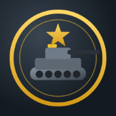

# Iron Doctrine

A real-time strategy game in the spirit of the classic early-2000s modern-warfare RTS, built for
the phone: three factions, base building, supply economies, generals powers, superweapons and a
skirmish AI. Landscape, touch-first, runs in the browser and packages as a native iOS/Android app.



## The factions

| | Coalition | Dominion | Insurgency |
| --- | --- | --- | --- |
| Style | Expensive, high-tech, air power | Numbers, atomic power, hordes | Cheap, sneaky, no power needed |
| Economy | Supply Lifter helicopters | Supply Trucks | Workers (also build) |
| Signature units | Bulwark tank, Guardian laser tank, Javelin missile artillery, Raptor gunship, Falcon jet, Spectre bomber, Pathfinder sniper | Warlord tank (horde bonus), Shredder AA, Inferno flame tank, Ember Cannon, Behemoth, Atom Cannon, Twin-Rotor, Vulture, Hacker, Lotus (hero) | Militia, Demolition Runner, Riot Mob, Marksman (hero), Gun Truck, Viper, Ravager, Flak Truck, Barrage Buggy, Toxin Sprayer, Demolition Truck, Ballistic Launcher |
| Defences | Aegis missile battery | Shredder turret, Speaker Tower (heals) | Missile Nest, Tunnel Network, Demo Trap |
| Tech | Strategy Center (battle plans), Supply Drop Zone | Doctrine Hall | Citadel, Black Market |
| Superweapon | **Solar Lance** — steerable orbital beam | **Atomic Silo** — nuclear missile | **Rocket Storm** — nine toxin missiles |
| Generals powers | Spy Drone, Paratroopers, Emergency Repair, Thunderbolt Strike, Fuel-Air Bomb | Cash Hack, Cluster Mines, Emergency Repair, Artillery Barrage, EMP Pulse, Carpet Bomb | Militia Ambush, Cash Bounty, GPS Scrambler, Toxin Strike, Sneak Attack |

Everything in `src/core/data.ts` is data: units, structures, weapons, armour table, upgrades and
powers. Tweak numbers there without touching the engine.

## How it plays

- **Tap** a unit or building to select; **double-tap** selects everything of that type on screen.
- **Tap the ground** to move, tap an enemy to attack, tap a supply pile with a gatherer to harvest.
- **Drag** to pan, **pinch** to zoom, **hold then drag** to box-select.
- Select a **Dozer / Worker**, pick a structure from the command bar, tap where to put it, tap again to confirm.
- Select a **building** to train units (hold a button to cancel it from the queue) and set a rally point.
- Infantry **capture** oil derricks and enemy structures. Vehicles crush infantry. Veterans get chevrons.
- Destroying things earns **rank**; spend generals points with the ★ button; powers sit in the right-hand column.
- Superweapons charge for four minutes; everyone gets a warning and a countdown.
- Fog of war, stealth and detection, low-power penalties, salvage crates, tunnels, hordes: they are all in.
- Desktop: WASD pan, left-drag select, right-click command, A attack-move, S stop, F select army, H home, 1–4 groups (Ctrl to assign).

## Run it

```bash
npm install
npm run dev          # http://localhost:5173 — open on your phone over the LAN, or in a desktop browser
npm run build        # production build in dist/
```

The build is a PWA: open it in Safari on an iPhone and use *Add to Home Screen* to get a
full-screen, landscape-locked app without going through Xcode.

## Native iOS / Android apps

```bash
npm run cap:sync     # build the web game and copy it into ios/ and android/
npm run ios          # opens Xcode (needs a Mac, Xcode, CocoaPods: cd ios/App && pod install)
npm run android      # opens Android Studio
```

Both apps are locked to landscape. Before submitting to the stores set your own bundle id in
`capacitor.config.ts` (`appId`) and run `npx cap sync`, then sign with your developer accounts.
Icons and splash screens are already generated (`public/icon-1024.png` is the source).

## Testing

```bash
npm test             # scenario tests: economy, jets, capture, tunnels, superweapons, every power…
npm run sim -- dust coalition dominion 20   # headless AI-vs-AI match on a map for N minutes
```

## Where things live

| File | What it does |
| --- | --- |
| `src/core/data.ts` | All faction content and the damage/armour table |
| `src/core/map.ts` | Map layouts (four maps) and terrain generation |
| `src/core/path.ts` | A* pathfinding with string-pulling |
| `src/game/game.ts` | Simulation: orders, movement, economy, construction, production, power, victory |
| `src/game/combat.ts` | Targeting, weapons, projectiles, lingering fields, damage |
| `src/game/powers.ts` | Generals powers and the three superweapons |
| `src/game/ai.ts` | Skirmish AI (easy / medium / hard) |
| `src/game/fog.ts` | Shroud and visibility |
| `src/render/models.ts` | Procedural low-poly models for every unit and structure |
| `src/render/scene.ts` | three.js scene, terrain, fog-of-war shading, entity views, picking |
| `src/render/effects.ts` | Particles, tracers, flashes, beams |
| `src/ui/controller.ts` | Taps and buttons → game commands, selection, modes, camera |
| `src/ui/hud.ts` | Command bar, minimap, powers column, alerts, promotion panel |
| `src/ui/input.ts` | Touch and mouse gestures |
| `src/ui/menus.ts` | Main menu, skirmish setup, settings, results |
| `src/audio.ts` | Synthesized sound effects and voice announcements |

No external art or audio: every model is built from primitives in code and every sound is
synthesized, so the repository has no licensing baggage.
